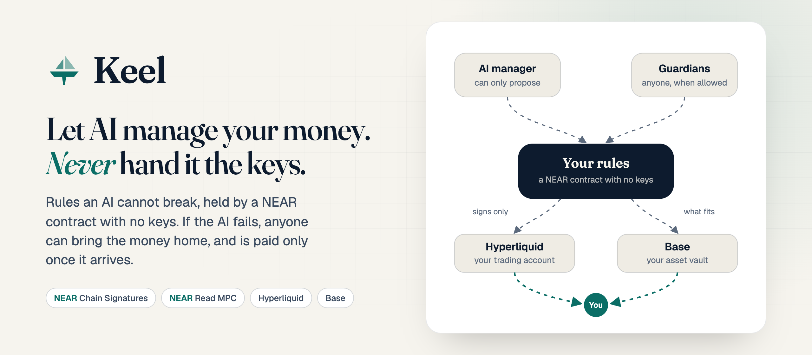

<div align="center">

<picture>
  <source media="(prefers-color-scheme: dark)" srcset="docs/assets/cover-dark.png">
  
</picture>

&nbsp;

[](https://github.com/Femtech-web/Keel/actions/workflows/ci.yml)
[](LICENSE)


### Keel lets investors give AI agents authority to manage their money, without giving them unrestricted control.

Every trade must obey the investor's rules, held by a NEAR contract that has no keys. If the manager fails,
any guardian can bring the money home, and is paid only once the investor's address shows it arrived.

**[ Judge it in 5 minutes ↗ ](JUDGES.md)** &nbsp;·&nbsp; **[ Rescue it yourself ↗ ](docs/practice.md)** &nbsp;·&nbsp; **[ The live rescue ↗ ](docs/results/g7/README.md)** &nbsp;·&nbsp; **[ The AI replay ↗ ](docs/results/replay/README.md)** &nbsp;·&nbsp; **[ Try to break it ↗ ](docs/try-to-break-it.md)**

Built for the **NEAR Hackathon**, November 2026.

</div>

---

## Contents

- [The problem](#the-problem)
- [What Keel does](#what-keel-does)
- [Proof: nothing here is a mockup](#proof-nothing-here-is-a-mockup)
- [Judge it in five minutes](#judge-it-in-five-minutes)
- [Rescue it yourself](#rescue-it-yourself)
- [How it works](#how-it-works)
- [Why it needs NEAR](#why-it-needs-near)
- [Build and test](#build-and-test)
- [Repository](#repository)
- [What it does not do](#what-it-does-not-do)

## The problem

AI agents can trade now. In Alpha Arena's Season 1.5, AI models were each given $10,000 to trade on
Hyperliquid. **30 of 32 ended with less than they started**; together, $319,878 became $176,849. The worst
turned $10,000 into $325.

An investor who wants an AI to manage money today has to hand it the keys, directly or through whoever runs
it. Then nothing limits what it does, and if it fails or simply stops, nobody can step in without the same
keys. The only alternatives are trusting the operator or not using the agent at all.

## What Keel does

The investor sets the rules once: order size, price band, maximum leverage, a loss floor, whether a silent
manager should trigger an exit, and the investor's own payout addresses. They live in **a NEAR contract with
no keys** (the judge). It is the only thing that can make NEAR's MPC network sign for the strategy's accounts
on Hyperliquid (`KeelLeg`) and Base (`KeelVault`), and both accounts can only ever pay the investor.

| Who | Can | Cannot |
|---|---|---|
| **The AI manager** | propose orders; the judge signs those that fit the rules, on cross-chain state verified by NEAR's MPC network | move funds, change the rules, stop a rescue |
| **Any guardian**, person or AI | run the rescue once the judge sees a trigger: the floor, the investor's request, or a silent manager if the investor chose that | choose an order, redirect a cent, be paid before the money arrives |
| **The investor** | exit at any time, and never be locked out | (nothing else is needed) |

The rules are code. This is part of what the judge checks before it signs a manager's order
([`engine/mandate.rs`](crates/keel-core/src/engine/mandate.rs)):

```rust
let val = self.valuation(&ev)?;                       // liquidation value, from attested evidence on both chains
if val.below_floor {
    return Err(Error::Mandate("equity-below-floor"));   // past the investor's floor, only a rescue may act
}
if self.silent(now) && p.on_silence == OnSilence::Exit {
    return Err(Error::Mandate("manager-silent"));       // a late manager may not race the guardians
}
if sz == 0 || sz > p.max_order_sz || sz % l != 0 {
    return Err(Error::Mandate("size"));
}
if limit_px.abs_diff(mark) as u128 * 10_000 > mark as u128 * p.band_bp as u128 {
    return Err(Error::Mandate("price-outside-band"));
}
```

## Proof: nothing here is a mockup

Every row is a transaction you can open, a dataset you can rebuild, or a contract you can read now.

| What | Result | Evidence |
|---|---|---|
| **A live rescue**: an AI manager (Claude) trades under the rules, a trade past its limit is refused, it goes silent, a guardian rescues both legs | 7.887 USDC and 0.006 WETH reached the investor; **only then** 0.5 + 0.3 NEAR were paid | [docs/results/g7](docs/results/g7/README.md) |
| **The investor's own exit**, rescued by hand | 2 USDC and 0.002 WETH home, each leg paid once | [docs/results/g7](docs/results/g7/README.md) |
| **20 bypass attempts** on the live, locked judges: a forged $1M snapshot, strangers, the AI's own key, replays | **20 of 20 refused** on chain | [docs/try-to-break-it.md](docs/try-to-break-it.md) |
| **The AI replay**: 32 Alpha Arena agents, fill by fill, through Keel's rules (3x cap, floor 30% down) | **+$56,772** to investors; 23 stopped at the floor; the rebuild matches Hyperliquid's own equity points within a median 1.3% | [docs/results/replay](docs/results/replay/README.md) |
| **4 locked contracts**: both run judges, the factory, the practice judge | 0 access keys; deployed code = the source build | [run judges](docs/results/g7/code-hashes.txt), [factory](docs/results/factory/code-hashes.txt) |
| **Self-serve**: a strategy created through the locked factory, its EVM accounts at addresses fixed in advance | one NEAR transaction; judge locked from birth; 6 of 6 checks pass | [docs/results/factory](docs/results/factory/README.md) |
| **The daily drill**: the practice strategy fails on purpose and is rescued, every day | every cycle recorded, failures included | [docs/results/drill](docs/results/drill) |
| **Mainnet privacy**: 3 USDC from Hyperliquid into a NEAR Intents confidential balance | the recipient and its balance are hidden; the amount is not | [docs/results/mainnet](docs/results/mainnet/README.md) |

## Judge it in five minutes

[JUDGES.md](JUDGES.md) is the full guide; the site's `/judges` page runs its checks live. In order:

1. **The problem in real money.** [The replay](docs/results/replay/README.md): what 32 AI traders did, and
   what a floor would have changed.
2. **Nobody can change the rules.** Read any judge: `view_access_key_list` returns no keys, and `view_code`
   hashes to the build ([how](docs/trust-model.md)).
3. **A rescue, end to end.** [The live run](docs/results/g7/README.md): every step a transaction, both chains.
4. **Try to break it.** [Every attempt and its refusal](docs/try-to-break-it.md), with the command to repeat it.
5. **Rescue it yourself** (optional, about 45 minutes): below.

## Rescue it yourself

A real strategy on testnet fails every day on purpose: its manager goes silent, and the investor's mandate says
a silent manager means exit. From **14:40 to 17:40 UTC** anyone may rescue it, and its judge pays whoever
delivers. You need Node 20+, Python 3.10+ and a free NEAR testnet account:

```bash
git clone https://github.com/Femtech-web/Keel && cd Keel && npm ci
npx near account create-account sponsor-by-faucet-service <you>.testnet autogenerate-new-keypair \
  save-to-legacy-keychain network-config testnet create
make rescue ACCOUNT=<you>.testnet
```

You attest the evidence, open the rescue and settle it; the judge checks every step and pays your account per
leg delivered. The courier pays the EVM gas and can change nothing. Details: [docs/practice.md](docs/practice.md).

## How it works

<picture>
  <source media="(prefers-color-scheme: dark)" srcset="docs/assets/architecture-dark.png">
  
</picture>

1. **Evidence in.** `KeelLeg` reads its own position and margin from HyperCore and emits a `Snapshot`;
   `KeelVault` emits its `Balance`. Anyone submits these logs to the judge, which asks NEAR's MPC network to
   verify them against finalized blocks (**Read MPC**). Nothing the judge acts on comes from us.
2. **Orders out.** The judge checks a manager's proposal against the rules on that evidence and, only if it
   fits, has the MPC network sign it for `KeelLeg` (**Chain Signatures**). Anyone relays it; `KeelLeg` runs
   only orders with that signature, within limits fixed in its own code.
3. **The rescue.** When the judge sees a trigger, any guardian may open a rescue on evidence it attested. The
   judge plans every order itself (reduce-only, bounded loss), signs the margin's sweep and the vault's exit,
   and pays each leg's reward only after the investor's address shows the delivery.

The trust model, including what NEAR's MPC network is trusted for, is in [docs/trust-model.md](docs/trust-model.md).

## Why it needs NEAR

- **Chain Signatures** let one locked contract control accounts on two other chains, with keys only it can
  use. No bridge, no multisig, no key anyone holds.
- **Read MPC** lets that contract verify what happened on those chains (a log, in a finalized block) before it
  acts, instead of trusting a reporter.
- **Locked accounts** make the rules final: a NEAR account with no access keys cannot be changed by anyone,
  and the factory creates every judge that way from its first block.
- **Confidential Intents** can receive a rescue's payout without revealing who got it
  ([the mainnet test](docs/results/mainnet/README.md)).

## Build and test

```bash
make test        # Rust rules and engine, Foundry, end to end through the judge, both NEAR contracts
make replay      # the Alpha Arena replay, from the cached fills (make replay-fetch refreshes them)
make factory     # the judge and the factory (cargo-near), with their sha256
make web-test    # the site: lint, types, unit tests, and Playwright with an accessibility audit
```

| Suite | Tests |
|---|---|
| Rust: rules, engine, replay (`crates/`) | 57 |
| Foundry: `KeelLeg`, `KeelVault`, `KeelDeployer` (`contracts/evm`) | 43 |
| End to end through the judge (Foundry + `keel-judge`) | 9 |
| NEAR contracts: the judge and the factory | 18 |
| Site: unit tests | 18 |
| Site: every page in light, dark and mobile, with a WCAG 2.2 AA audit (Playwright) | 60 |

Requires Rust, Foundry, Python 3 and Node.js. CI runs all of it on every push, with a gitleaks secret scan and
a check that the replay reproduces byte for byte. A tagged release builds the binaries, the contracts and their
SHA256SUMS.

## Repository

| Path | What |
|---|---|
| `contracts/near-keel/` | The judge: Read MPC attestation in, MPC signatures and rewards out |
| `contracts/near-keel-factory/` | The factory: creates each judge locked from birth, keeps the registry |
| `contracts/evm/` | `KeelLeg` (Hyperliquid), `KeelVault` (Base), `KeelDeployer` (CREATE2); `test/sim/` is a **simulation** of HyperCore |
| `crates/keel-core/` | The rules in pure Rust: `evidence`, `eip712`, `readmpc`, `mpc`, `engine/{orders,valuation,mandate,repair,deleverage,rescue}`; the `keel-judge` CLI |
| `crates/keel-replay/` | The Alpha Arena replay |
| `agents/` | The AI manager and guardian, the daily drill, the courier, and `rescue.py` for visiting guardians |
| `scripts/` | Testnet runbooks (`g7.sh`, `factory.sh`, `practice.sh`), the drill's schedule, key generation |
| `web/` | The site (Next.js 16): the product, the proof, and the judges' guide, read live from the chains |
| `docs/` | The design, the trust model, the attacks, and `results/`: every live transaction, log and AI decision |

| Read | For |
|---|---|
| [docs/architecture.md](docs/architecture.md) | the pieces, the module map, and why everything waits for evidence |
| [docs/rescue.md](docs/rescue.md) | triggers, both legs, every failure case, and the exact liquidation value |
| [docs/trust-model.md](docs/trust-model.md) | what "no keys" does and does not mean, and how to check each claim |
| [docs/privacy.md](docs/privacy.md) | what is public, what could be private, and the trade-off Keel cannot escape |
| [docs/landscape.md](docs/landscape.md) | who already does what, and where Keel is and is not different |
| [docs/practice.md](docs/practice.md) | the practice strategy and how to rescue it |
| [docs/human-guardian.md](docs/human-guardian.md) | running a rescue by hand |
| [agents/README.md](agents/README.md) | the AI manager and guardian, and how their decisions are logged |

## What it does not do

- **Testnets only**, except one authorized mainnet privacy test. **Nothing here is audited.**
- One market: an ETH perpetual on Hyperliquid, with WETH on Base as the spot leg.
- NEAR's MPC network is trusted to sign and to verify honestly. That trust is NEAR's, not Keel's, and the
  [trust model](docs/trust-model.md) says exactly where it applies.
- The replay is a counterfactual: Keel's rules applied to real fills, with the closing cost modelled.
- The daily drill and the courier run on the operator's machine; the courier only pays gas.

Keys and secrets never enter the repository (`.secrets/`, `.env`, and a gitleaks pre-commit hook in
`.githooks/`).

## License

[MIT](LICENSE).
