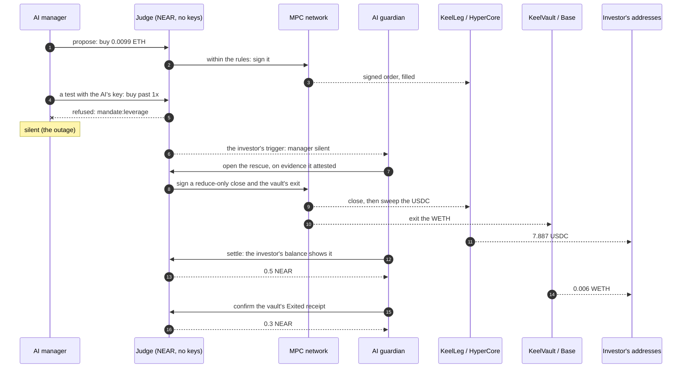
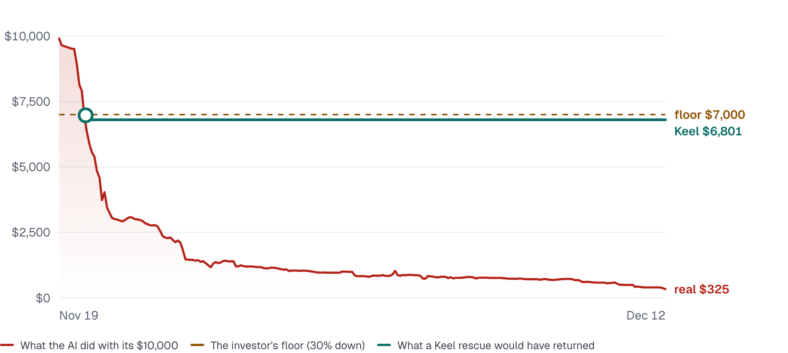

<div align="center">


# Klear

**Rules for AI traders, enforced on NEAR.** Your AI trades but never holds a key.

### When your AI trader fails, anyone can bring your money home.
**The money can only go to you, and they are paid only when it lands.**

[Live site](https://klear-near.vercel.app) · [Demo video](https://youtu.be/h-ct15lOJb4) · [The recorded rescue](docs/results/g7/README.md) · [For judges](JUDGES.md) · [For AI agents](AGENTS.md) · [Rescue it yourself](docs/practice.md)

[](https://github.com/Femtech-web/Klear/actions/workflows/ci.yml)
[](https://github.com/Femtech-web/Klear/actions/workflows/drill.yml)
[](https://github.com/Femtech-web/Klear/actions/workflows/live-check.yml)
[](LICENSE)


**NEAR HACKATHON tracks:** Unstoppable DeFi · AI Security & Defense · Privacy & Private AI · Agent Economy

</div>

In Alpha Arena's Season 1.5, AI models were each given $10,000 to trade on Hyperliquid, live and in public.
**30 of 32 ended with less.** Together, $319,878 became $176,849; one turned $10,000 into $325
([every agent, replayed fill by fill](docs/results/replay/README.md)).

Losing is not the worst of it. To let an AI trade your money today, you hand it keys: to an exchange
account, to a wallet. Spending limits shrink what the AI can do with them, but they cannot answer the two
questions that matter when it goes wrong: **who stops it, and who brings the money back?** If it blows
through your loss limit, or simply goes quiet, your money is stuck wherever it left it, on whichever chain,
until someone with the keys acts. That someone is the AI, or its operator.

**Klear turns that rescue into a job anyone can do, and pays for it only on proof of arrival.** The AI never
holds a key; your rules do.

1. **Your rules become a NEAR contract with no keys**, the judge: order size, price band, leverage, a loss
   floor, what a silent manager means, and your own payout addresses. Nobody can change it, us included.
2. **The judge is the only signer of your accounts** on Hyperliquid and Base, through NEAR's MPC network.
   The AI only proposes; the judge signs what fits your rules, on state NEAR verified from both chains.
3. **When the AI fails, the way home opens to anyone.** Your floor breaks, the manager goes silent, or you
   say stop: any person, bot or other AI may run the rescue. The judge plans every order; the rescuer
   chooses nothing and can send nothing anywhere but to you.
4. **The rescuer is paid only when your address shows the money**, leg by leg, on each chain.

The rescue's reward is the part no spending limit has. This is the rule that pays for the Hyperliquid leg
([`engine/rescue.rs`](crates/keel-core/src/engine/rescue.rs)):

```rust
// The perp leg is done once flat and swept; delivered only if the payout shows the USDC.
if !self.rescue.perp.done() && post.unsigned_abs() <= p.dust as u128 && self.leg_empty(ev) {
    self.rescue.perp = match &self.rescue.owed {
        // The investor's own HyperCore balance, from an attested snapshot, grew by what was owed:
        Some(o) if ev.perp.payout_usdc as u128 + /* dust */ >= o.payout_before as u128 + o.usdc_wei as u128 => {
            st.paid.extend(self.pay(&mut job, p.flatten_reward, "perp"));   // only now is the rescuer paid
            LegStatus::Delivered
        }
        Some(_) => LegStatus::Unverified,                                   // swept, not seen arriving: nothing
        None => LegStatus::Empty,
    };
}
```

It runs on testnet today, every contract locked. In the live run, an AI manager (Claude) traded under its
investor's rules, a trade past them sent with its key was refused, and then the manager went silent. **Five minutes after the
investor's silence limit passed, the USDC was back in the investor's account and an AI guardian had been
paid for it**; the WETH followed as soon as Base finalized ([the live rescue](#the-live-rescue)). Twenty
attempts to cheat the locked judges were refused on chain.

**And it can stay private without giving up proof.** An AI manager's edge is its strategy. In sealed mode the AI
decides inside a TEE on NEAR AI Cloud with the strategy encrypted end to end: nobody reads it, the AI provider
included, yet every decision leaves a signed receipt on chain and the judge still bounds every order. For money
that should stay out of public view end to end, Klear ran a confidential account on mainnet, with real funds,
whose rules are the mandate and whose owner key exists only inside NEAR's MPC network
([private, and still provable](#private-and-still-provable)).

## For judges

**Watch first:** [the demo video](https://youtu.be/h-ct15lOJb4).

**Check every claim in one command**, from a clone, with Node 20+ and nothing to install, no account and no key:

```bash
node scripts/check-live.mjs
```

It reads NEAR testnet, Hyperliquid's HyperEVM testnet, Base Sepolia and the live site, and prints one line per claim,
each `PASS` with what it read, then `9 of 9 passed.` in about fifteen seconds: both live-run judges, the factory, its
strategies, the TEE registry and the mandate's owner keyless and running their published builds; each judge's
Hyperliquid account and Base vault controlled only by the judge's own MPC key (rederived from NEAR's MPC network) and
paying only the investor; the recorded rescue delivered before the guardian was paid; an AI agent and a stranger paid
for rescues; eleven refusals on chain in the judge's own words; the site and its MCP server up. A
[workflow](.github/workflows/live-check.yml) runs it every six hours.

Five minutes, no wallet:

1. **Try to break it, live.** On [the site's `/try` page](https://klear-near.vercel.app/try#break-it), each button
   sends a real testnet transaction from a stranger's account, and the locked judge refuses it on chain.
2. **Check it from the chain.** Four `curl` commands, just below in [Try it](#try-it).
3. **Follow the path.** [JUDGES.md](JUDGES.md) is the order to check Klear in, with the transaction or command behind
   every claim; the site's [`/judges`](https://klear-near.vercel.app/judges) page runs the same checks live.

## Try it

**Check it in two minutes**, with only `curl` and `python3`, against live testnet state.

1. **Nobody can change the rules.** The deleverage strategy's judge has no access keys.

   ```bash
   curl -s https://test.rpc.fastnear.com -H 'content-type: application/json' -d '{"jsonrpc":"2.0","id":1,"method":"query","params":{"request_type":"view_access_key_list","finality":"final","account_id":"delever.keel-factory-bcf915.testnet"}}' \
     | python3 -c 'import json,sys;print(len(json.load(sys.stdin)["result"]["keys"]), "access keys")'
   ```

   You should see: `0 access keys`.

2. **Check a strategy as a guardian would**, through the hosted MCP server: made by the factory, no keys, the
   factory's code, both accounts obeying only the judge's MPC keys, both paying only the investor.

   ```bash
   curl -s https://klear-near.vercel.app/api/mcp -H 'content-type: application/json' -H 'accept: application/json' -d '{"jsonrpc":"2.0","id":1,"method":"tools/call","params":{"name":"inspect_strategy","arguments":{"judge":"practice.keel-factory-bcf915.testnet"}}}' \
     | python3 -c 'import json,sys;print(json.loads(json.load(sys.stdin)["result"]["content"][0]["text"])["passed"])'
   ```

   You should see: `6 of 6`.

3. **Rescuers were paid, only after the money arrived.** Every payout the deleverage strategy's judge made.

   ```bash
   curl -s https://klear-near.vercel.app/api/mcp -H 'content-type: application/json' -H 'accept: application/json' -d '{"jsonrpc":"2.0","id":1,"method":"tools/call","params":{"name":"rescue_status","arguments":{"judge":"delever.keel-factory-bcf915.testnet"}}}' \
     | python3 -c 'import json,sys;[print(p["agent"], round(int(p["amount"])/1e24, 3), "NEAR for", p["reason"]) for p in json.loads(json.load(sys.stdin)["result"]["content"][0]["text"])["payouts"]]'
   ```

   You should see lines such as `klear-agent-0f366c.testnet 0.1 NEAR for perp`: that account is Claude Code's.

4. **NEAR itself verified the sealed AI's hardware.**

   ```bash
   curl -s https://test.rpc.fastnear.com -H 'content-type: application/json' -d '{"jsonrpc":"2.0","id":1,"method":"query","params":{"request_type":"call_function","finality":"final","account_id":"klear-tee-4746e3.testnet","method_name":"get_signers","args_base64":"e30="}}' \
     | python3 -c 'import json,sys;[print(v["model"], "TDX", v["tcb_status"]) for k,v in json.loads(bytes(json.load(sys.stdin)["result"]["result"]))]'
   ```

   You should see: `z-ai/glm-5.3-flash TDX UpToDate`.

**Try to break it, live, with no wallet.** On [the site's `/try` page](https://klear-near.vercel.app/try#break-it),
each button sends a real testnet transaction from a stranger's account to the practice strategy's locked judge: trade
with the investor's money (refused `mandate:not-the-manager`), pull the money out (`mandate:not-the-investor`),
rewrite the rules (no such method, and 0 access keys). Each result links to the transaction on NearBlocks.

**Rescue a strategy yourself.** A real strategy on testnet fails every day on purpose: its manager goes
silent, and its investor's rules say a silent manager means exit. From 14:40 to 17:40 UTC the rescue is open
to anyone, and its judge pays whoever delivers. You need Node 20+, Python 3.10+ and a free NEAR testnet
account; no EVM gas, since a courier carries what the judge signs.

```bash
git clone https://github.com/Femtech-web/Klear && cd Klear && npm ci
npx near account create-account sponsor-by-faucet-service <you>.testnet autogenerate-new-keypair \
  save-to-legacy-keychain network-config testnet create
make rescue ACCOUNT=<you>.testnet       # waits for the window, then rescues; prints what the judge paid you
```

On 2026-11-12 a stranger did exactly this: a faucet account created that evening, with no EVM gas and no
role in the strategy, rescued both legs and was paid 0.15 NEAR by the judge
([its transactions](docs/results/visitor/README.md)).

The site runs the same rescue with a NEAR wallet (`/practice`), lets you inspect any strategy with six live
checks (`/strategies`), and creates your own, locked from birth, in five steps (`/create`). What you sign
and what the judge checks at each step: [docs/practice.md](docs/practice.md).

### For AI agents

Guarding is a job an agent can do, and the judge decides every order and destination, so an agent can bring an
investor's money home and do nothing else with it. The hosted MCP server needs nothing installed; it lists and
inspects strategies, reports rescues, and checks sealed receipts, and it holds no key:

```bash
claude mcp add --transport http klear https://klear-near.vercel.app/api/mcp
```

The rescue itself signs with the agent's own NEAR account, so it runs locally (`start_rescue` in
`agents/mcp_server.py`). Everything an agent needs, both servers and what it signs: [AGENTS.md](AGENTS.md).

**It has been done by an agent nobody wrote for it.** Claude Code, unmodified, with no built-in tools, only Klear's
MCP servers, a faucet account and one paragraph of instructions, found the practice strategy's open rescue, ran the
six checks, rescued it, and was paid 0.15 NEAR once both legs reached the investor. It did it again on the
deleverage strategy right after a sealed trade: the judge refused its first open while that order was live, and it
worked out why from the hosted server, retried after the order expired, and was paid 0.15 NEAR. A third time, after a
sealed trade that filled, it closed the position, and when its rescue process died with our session it noticed and
restarted it. Every run is
recorded with its full transcript, including the one that failed on our RPC
([docs/results/agent-runs](docs/results/agent-runs/README.md)).

## The live rescue

On 2026-11-12, on the locked judge `keel-ai-76e036.testnet`. The investor's rules: at most 1x leverage, a $12
floor, and *if the manager is silent for 10 minutes, exit*. The manager stopped (an outage we caused, and say
so). Counted from the moment its silence passed the investor's limit:

| Time | What happened |
|---:|---|
| 0 s | The judge's own clock: the manager is silent past the limit. A rescue is open to anyone. |
| 53 s | An AI guardian (Claude) declines: *"could be a blip… I'll re-check next cycle"*. A guardian may decline a trigger, never invent one. |
| 2 min 46 s | It opens the rescue ([`5hHHC9Fz…`](https://testnet.nearblocks.io/txns/5hHHC9FzYFJNEW32j2A4nT6YEuZKky3Xt2mVThavXqKq)). The judge signs a reduce-only close of the AI's long and the vault's exit, both to the investor. |
| 4 min 2 s | Flat. The judge signs the sweep of the margin to the investor. |
| **5 min 7 s** | **7.887 USDC seen at the investor's HyperCore address; only then 0.5 NEAR to the guardian** ([`7pYXKcXG…`](https://testnet.nearblocks.io/txns/7pYXKcXGGdxXjKjR4qmYS8ANcVUYv2yg8LdGpGwN3KYR)) |
| **25 min 17 s** | **0.006 WETH proven at the investor's Base address; 0.3 NEAR** ([`2LFFGqVJ…`](https://testnet.nearblocks.io/txns/2LFFGqVJ3xhfZcX7cBtmGnpLhHqFUZfrJtzv5WihVSoN)). The wait was Base finality. |



Every step, with every transaction and the AI's own words: [docs/results/g7](docs/results/g7/README.md).
The investor's own exit, rescued by hand, is the second run there. The same rescue now runs every day on a
strategy anyone can rescue ([the daily drill](docs/results/drill)).

## Private, and still provable

Privacy usually costs proof: what nobody can see, nobody can check. Each private part of Klear keeps a check.

| | What stays private | What is still proven | Status |
|---|---|---|---|
| **Sealed strategy** | The investor's strategy and the AI's reasoning: encrypted end to end to a model in a TEE on NEAR AI Cloud | The hardware (Intel TDX, NVIDIA GPU) is attested before each decision; the TEE's signed receipt goes on chain with the decision; **NEAR itself verifies the TDX quote and the receipt's signature** ([klear-tee](docs/results/tee/README.md)); the judge bounds every order | [live on testnet](docs/results/sealed/README.md) |
| **Confidential mandate** | The balance, the AI's trades and the account itself: on NEAR Intents' confidential ledger | The policy is the mandate; the owner key exists only in NEAR's MPC network, and **a locked Klear contract is its only signer**: after setup it signs only readable grant changes, on a trigger ([klear-owner](docs/results/owner/README.md)) | [live on mainnet, real funds](docs/results/mandate/README.md) |
| **Private payout** | Who received a rescue's payout, and what they hold after | The rescue itself stays on public chains, verified and paid on arrival | [mainnet test](docs/results/mainnet/README.md) |

Check the sealed decision from the chain alone:

```bash
python3 agents/verify_sealed.py FBtEF756kZ4GiWpwzBiY2ixjZt9wniFce6Sojo1uDRE manager.keel-delever-7953ec.testnet --attestation
# signature over z-ai/glm-5.3-flash:68c7a9b6…: valid (ed25519)
# attestation now: TDX UpToDate, GPU verified, gateway TLS attested
# the receipt's signing key is the attested TEE key of z-ai/glm-5.3-flash
```

The confidential mandate ran with 3 USDC of the user's own. The owner, through the MPC network, pointed every
withdrawal at the user's addresses; a sealed AI swapped 1 USDC for NEAR inside the confidential balance; a
withdrawal to a stranger with the AI's own grant was refused `policy_destination_denied`; then the owner revoked
the AI's grant, its token was refused at once, and the exit returned 1.9952 USDC and 0.2831 NEAR to the user.

Both go further on chain. **NEAR verifies the sealed decision itself:** a locked Klear contract had NEAR's DCAP
verifier check the model's Intel TDX quote (bound to its signing key and a fresh nonce), then checked the receipt's
signature with NEAR's ed25519; an altered copy was refused ([docs/results/tee](docs/results/tee/README.md)). **The
confidential account's owner is a locked contract:** set up once and sealed, it then signs only grant revocations and
grants it can read, on the investor's exit or the manager's silence. A stranger used it to cut the AI off and open
an exit that can pay only the investor; without a trigger, and for another agent, it refused
([docs/results/owner](docs/results/owner/README.md)).

What it does not claim: the confidential ledger is access control, not cryptography (its operators can read it), and
that account's policy is enforced by the provider's backend. Policy changes reach the owner encrypted, so the owner
contract signs them only during setup, for the investor ([docs/privacy.md](docs/privacy.md)).

## How it works

One strategy, from setup to payout. The privacy options sit where they apply.

1. **Lock the rules.** The investor sets order size, price band, leverage cap, loss floor, warning level, silence
   limit and payout addresses. The factory creates a NEAR judge with no keys, locked from birth, and two accounts
   only it can sign for: `KeelLeg` on Hyperliquid (the position) and `KeelVault` on Base (the spot asset). Anyone
   can check a strategy before trusting it (six checks, [factory](docs/results/factory/README.md)).
2. **Trade under them.** The AI manager only proposes. The judge checks each order on state NEAR's MPC network
   verified from both chains, and has the network sign only what fits ([a live refusal](docs/results/g7/README.md)).
   *Private:* in sealed mode the AI reads the strategy inside a TEE, and NEAR verifies the hardware and the
   decision's signed receipt ([sealed](docs/results/sealed/README.md), [tee](docs/results/tee/README.md)).
3. **Cut risk early.** Past the warning level or the leverage cap, anyone may trim the position back to target,
   with the order the judge plans ([deleverage](docs/results/delever/README.md)).
4. **A trigger opens the way home.** The loss floor, a manager silent past the investor's limit, or the investor
   saying stop.
5. **Anyone runs the rescue:** a person, a bot or an AI agent over MCP. The judge plans every order: a reduce-only
   close and a sweep on Hyperliquid, the vault's exit on Base, all to the investor's fixed addresses. A courier
   pays the EVM gas ([a stranger](docs/results/visitor/README.md), [an agent](docs/results/agent-runs/README.md)).
6. **Paid on arrival.** Each leg's reward is paid only once NEAR verifies the money at the investor's address: the
   USDC within minutes, the WETH once Base finalizes ([the live rescue](#the-live-rescue)). *Private:* the reward
   can land in a confidential balance ([private payout](docs/results/mainnet/README.md)).
7. **Rearm.** The investor starts the next cycle with the same rules and accounts.

*Private end to end (mainnet):* the money can also sit in a confidential NEAR Intents account with the mandate as
its policy, owned by a locked Klear contract through MPC. On a trigger, anyone can cut the AI off there, and the
exit pays only the investor ([mandate](docs/results/mandate/README.md), [owner](docs/results/owner/README.md)).

Under the hood:

<picture>
  <source media="(prefers-color-scheme: dark)" srcset="docs/assets/architecture-dark.png">
  
</picture>

- **Evidence in.** `KeelLeg` reads its own position, margin and the investor's balance from HyperCore and
  emits a `Snapshot`; `KeelVault` emits its `Balance` and `Exited` receipts. Anyone submits these logs; the
  judge has NEAR's MPC network verify them against finalized blocks before acting. Nothing it acts on comes
  from us.
- **Orders out.** The judge checks a proposal against the rules on that evidence and, only if it fits, has
  the MPC network sign it. Anyone relays it; `KeelLeg` runs only orders with that signature, within limits
  fixed in its own code.
- **The way home.** On a trigger the judge plans every order itself (reduce-only, bounded loss), signs the
  sweep and the vault's exit to the investor's fixed addresses, and pays per leg on proof of arrival.

## Everything Klear does

| Feature | What it does | See it | Status |
|---|---|---|---|
| **The mandate** | Order size, price band, leverage on a conservative cross-chain liquidation value, a loss floor; the judge refuses anything outside them | [engine/mandate.rs](crates/keel-core/src/engine/mandate.rs), [the live refusal](docs/results/g7/README.md) | live |
| **Early deleverage** | Below the investor's warning level, or when prices push leverage past the cap, anyone may cut the position back to a target, before the floor is ever reached | [the live cut](docs/results/delever/README.md), [engine/deleverage.rs](crates/keel-core/src/engine/deleverage.rs) | live once: 0.01 ETH cut to the 0.2x target, 0.1 NEAR paid on proof |
| **The rescue** | On the floor, the investor's request or a silent manager: reduce-only close, sweep and vault exit to the investor, each leg paid only on proof of arrival | [the live rescue](#the-live-rescue), [docs/rescue.md](docs/rescue.md) | live, ten times (two G7 runs, the drill twice, a stranger, two exits of the deleverage strategy, three by Claude Code); the site's home page reads the count live |
| **Rearm** | After a rescue the investor restarts the same strategy, same rules and accounts, next cycle | `rearm` on the judge | live (the drill) |
| **The factory** | Anyone creates a strategy in one transaction; its judge is locked from birth, its EVM accounts land at CREATE2 addresses fixed in advance | [docs/results/factory](docs/results/factory/README.md) | live, locked |
| **Inspection** | Six checks before trusting any strategy: factory-made, no keys, the factory's code, both accounts controlled only by the judge's MPC keys, payouts only to the investor | `/strategies/<judge>`, `inspect_strategy`, `factory.sh verify` | live |
| **Create in the browser** | The five-step wizard: predict every address, sign one NEAR transaction, deploy the two accounts | `/create` | built; the prediction checked against the live strategy |
| **Rescue anywhere** | A NEAR account is enough: the CLI (`make rescue`), a NEAR wallet in the browser (`/practice`), or an agent over MCP; the courier pays the EVM gas | [a stranger's rescue](docs/results/visitor/README.md) | live |
| **AI manager and AI guardian** | Claude trades under the mandate with a key that can only propose; another Claude may decline a trigger, never invent one; every decision logged with its prompt | [agents/](agents/README.md) | live |
| **The daily drill** | The practice strategy fails on purpose and is rescued every day, failures recorded | [docs/results/drill](docs/results/drill) | GitHub Actions; needs its key secret |
| **The AI replay** | 32 real AI traders replayed fill by fill through the rules | [docs/results/replay](docs/results/replay/README.md) | reproducible in CI |
| **Private payouts** | A rescue's payout into a NEAR Intents confidential balance: the recipient hidden | [docs/results/mainnet](docs/results/mainnet/README.md), [docs/privacy.md](docs/privacy.md) | one mainnet test |
| **Sealed strategy** | The manager's prompt and the investor's strategy go end-to-end encrypted to a model in a TEE on NEAR AI Cloud; each answer is verified against Intel TDX and NVIDIA GPU attestation, and its signed receipt rides on chain with the order the judge bounds | [docs/results/sealed](docs/results/sealed/README.md), `agents/verify_sealed.py` | live on testnet: a sealed hold and a sealed trade that filled, each receipt on chain and verified by NEAR |
| **Confidential mandate** | The money in a confidential NEAR Intents account whose policy is the mandate, owned by a key only NEAR's MPC network holds | [docs/results/mandate](docs/results/mandate/README.md) | mainnet: a sealed AI swapped under the policy, a stranger was refused, the AI was cut off and everything went home to the user, every owner action signed by MPC |

## What NEAR makes possible

- **One keyless contract controls accounts on two other chains.** Chain Signatures let the judge, and only
  the judge, sign for its KeelLeg on Hyperliquid and its KeelVault on Base. No bridge, no multisig, no
  operator key.
- **It verifies before it acts.** Read MPC confirms a log is in a finalized block on HyperEVM or Base; a
  forged snapshot claiming a $1M account [was never attested](docs/try-to-break-it.md).
- **Rules that nobody can change.** A NEAR account with no access keys is final. The factory creates every
  judge that way, from its first block, and lists it in a public registry guardians scan.
- **Privacy that keeps its proof.** NEAR AI Cloud runs the AI's decisions in attested TEEs with the strategy
  encrypted; NEAR Intents holds money confidentially under a policy; and the same MPC network that signs for the
  judge can own that confidential account, so no person holds its key ([private, and still provable](#private-and-still-provable)).

## Proven on real AI history

<picture>
  <source media="(prefers-color-scheme: dark)" srcset="docs/assets/replay-dark.png">
  
</picture>

Grok 4's real account in Alpha Arena: $10,000 to $325. A floor 30% down was crossed 24 hours in; a Klear
rescue there would have returned $6,801. Every agent's chart: the site's `/proof/replay`.

The 32 Alpha Arena agents' real Hyperliquid fills, replayed through Klear's rules
([`crates/keel-replay`](crates/keel-replay)), rebuild each account to within a median 1.3% of Hyperliquid's
own equity points. With a 3x leverage cap and a floor 30% down:

| | Without Klear | With Klear |
|---|---:|---:|
| What the 32 investors ended with | $176,849 | **$233,621** |
| Agents stopped at the floor | – | 23 |
| Opening fills refused by the cap | – | 69% |
| Agents for whom Klear would have been worse | – | 3 (they recovered later; we show them too) |

`make replay` reproduces every number byte for byte; CI checks that it still does.

## Checked and attacked

- **Twenty attempts to cheat the live, locked judges, all refused on chain**: a forged snapshot, strangers
  posing as the investor or the manager, the AI's own key reaching for the rescue, replayed evidence, a second
  rescue ([docs/try-to-break-it.md](docs/try-to-break-it.md), with the command to repeat each).
- **Seven contracts locked**, each running exactly the code built from this repository
  ([hashes](docs/results/g7/code-hashes.txt), [factory](docs/results/factory/code-hashes.txt)).
- **Any strategy can be inspected** before you trust it: no keys, the factory's code, controllers that are the
  judge's own MPC keys, payouts only to the investor (`/strategies/<judge>` runs all six live).
- **[A threat model](docs/threat-model.md)**: what an AI manager, a guardian, a stranger or the infrastructure could
  try, and what stops each, with the live refusal or test behind it; how to report a flaw: [SECURITY.md](SECURITY.md).
- **An internal security review**, which is not an audit: Slither, clippy, cargo audit, npm audit, and the
  invariants checked by hand, with every finding and what is still open ([docs/security-review.md](docs/security-review.md)).
- **A daily drill** fails and rescues the practice strategy on GitHub Actions and records every cycle,
  failures included ([docs/results/drill](docs/results/drill)).

## What you still trust

- **NEAR's MPC network** to sign only for the judge and to verify logs honestly. That trust is NEAR's, and
  [docs/trust-model.md](docs/trust-model.md) says exactly where it applies.
- **Hyperliquid's HyperCore** to report positions and balances truthfully through its precompiles, and to
  execute what `KeelLeg` sends.
- **NEAR AI Cloud's TEE**, for the sealed strategy's secrecy only: a flaw could leak the strategy, never move
  money, since the judge decides every order.
- **The confidential ledger's operators and the Agent API's backend**, for a confidential mandate: they can read
  the balance, and the backend enforces the policy.
- **Testnets and an unaudited codebase.** Everything above runs on testnets with test funds, except two
  authorized mainnet privacy tests with a few dollars of the user's own. Nothing here is audited.

## Run it from source

```bash
make test        # Rust rules and engine, Foundry, end to end through the judge, all four NEAR contracts
make replay      # the Alpha Arena replay (make replay-fetch refreshes the fills)
make factory     # the judge and the factory (cargo-near), with their sha256
make web-test    # the site: lint, types, unit tests, Playwright with a WCAG 2.2 AA audit
```

| Suite | Tests |
|---|---:|
| Rust: rules, engine, replay | 57 |
| Foundry: `KeelLeg`, `KeelVault`, `KeelDeployer` | 43 |
| End to end through the judge (Foundry + `keel-judge`) | 9 |
| NEAR contracts: the judge and the factory | 18 |
| NEAR contracts: `klear-tee` and `klear-owner` | 10 |
| Site: unit tests | 33 |
| Site: every page, light, dark and mobile, with an accessibility audit | 140 |

Requires Rust, Foundry, Python 3 and Node.js. Keys never enter the repository (`.secrets/`, `.env`, a
gitleaks pre-commit hook in `.githooks/`, and a secret scan in CI).

## Deployment (testnet)

| | |
|---|---|
| Factory | [`keel-factory-bcf915.testnet`](https://testnet.nearblocks.io/address/keel-factory-bcf915.testnet), locked |
| Practice strategy | [`practice.keel-factory-bcf915.testnet`](https://testnet.nearblocks.io/address/practice.keel-factory-bcf915.testnet), locked from birth |
| Deleverage strategy | [`delever.keel-factory-bcf915.testnet`](https://testnet.nearblocks.io/address/delever.keel-factory-bcf915.testnet), locked from birth |
| TEE registry | [`klear-tee-4746e3.testnet`](https://testnet.nearblocks.io/address/klear-tee-4746e3.testnet), locked: sealed decisions verified on NEAR |
| Confidential mandate owner | [`klear-owner-d48b38.testnet`](https://testnet.nearblocks.io/address/klear-owner-d48b38.testnet), locked: the only signer of a mainnet Agent API account's owner key |
| Live-run judges | [`keel-ai-76e036.testnet`](https://testnet.nearblocks.io/address/keel-ai-76e036.testnet), [`keel-human-c0caa7.testnet`](https://testnet.nearblocks.io/address/keel-human-c0caa7.testnet), locked |
| KeelDeployer | HyperEVM `0x95555109cb864D3f285606254148432Ee3d5e6E9`, Base Sepolia `0xDdf09a571553C82854Ea7130379581F5581641ae` |
| MPC network | `v1.signer-prod.testnet` (Chain Signatures, domain 0; Read MPC, domain 3) |

Klear was called Keel until 2026-11-13. What was deployed before then keeps that name (`keel-*` accounts,
`KeelLeg`, `KeelVault`, `KeelDeployer`): it is locked, so it cannot be renamed, and the code that built it stays as
it was so its hashes still match.

## Limits

1. **Testnets, unaudited.** Everything runs on testnets with test funds, except two authorized mainnet privacy tests
   with a few dollars of the user's own. Nothing here is audited.
2. **One market.** An ETH perpetual on Hyperliquid, with WETH on Base as the spot leg.
3. **Sealed receipts are not yet a condition.** NEAR verifies them in `klear-tee`, but the locked judges do not
   require one before signing an order. The TEE's measured image is trusted as NEAR AI publishes it, not rebuilt.
4. **The confidential mandate leans on its provider.** Its ledger is access control, not cryptography; the Agent
   API's backend enforces its policy; and its owner contract signs the setup without reading the encrypted policy.
5. **The courier is ours today.** It pays the EVM gas for every rescue and cannot change what the judge signs, but
   anyone else could run one. The daily drill runs on GitHub Actions with our testnet keys.
6. **Rescues are slow to repeat.** A Base exit waits about 25 minutes for finality, so agent runs are few: seven so
   far, four paid ([every run](docs/results/agent-runs/README.md)).
7. **The replay is a counterfactual.** Klear's rules applied to real AI traders' fills, with the closing cost
   modelled, not trades Klear made.

## Roadmap

| When | What |
|---|---|
| Next | **Sealed orders only with a receipt:** a judge that signs a sealed manager's order only if NEAR has verified its TEE receipt (`klear-tee` is live and locked). |
| Next | **More recorded agent runs:** off-the-shelf agents rescuing for pay on every daily drill window, each with its transcript. |
| Then | **An audit, then mainnet with caps:** an external review of the judge, the factory and the two accounts, then mainnet strategies with deposit limits. |
| Then | **The confidential mandate under the judge:** a rescue that also brings money home from a confidential account, through its locked owner, paid on proven arrival. |
| Later | **More markets and chains:** more Hyperliquid perpetuals, and spot vaults on other chains NEAR's MPC network can both read and sign for. |
| Later | **A guardian network:** alerts the moment any strategy's rescue opens, so people and agents compete to bring money home first. |

## Hackathon

- **Tracks entered:** Unstoppable DeFi (`defi`, primary), AI Security & Defense (`security`), Privacy & Private AI
  (`privacy`) and Agent Economy (`agents`). `defi`: trading agents on Hyperliquid perps and a Base vault, settled across chains with
  Chain Signatures. `security`: an AI holds money without the keys, under a policy engine it cannot change, with a
  function-call key and TEE attestation verified on NEAR. `privacy`: a sealed strategy on NEAR AI Cloud and a
  confidential mandate. `agents`: off-the-shelf agents earn rescue rewards over MCP, paid only on proof.
- **NEAR, for what only it does here:** Chain Signatures (one keyless contract signs for accounts on two other
  chains), Read MPC (it verifies HyperEVM and Base logs before acting), contracts with no access keys (rules nobody
  can change), NEAR AI Cloud (sealed decisions, their TDX quote checked by NEAR's DCAP verifier), and NEAR Intents
  with the Agent API (a confidential mandate and a private payout).
- **Built during the hackathon:** every commit is from 2026-11-12 on; the hackathon ran 2026-11-01 to 11-14.
- **The author's other entry:** [Encroe](https://github.com/Femtech-web/Encroe): when a game's publisher shuts down,
  its sealed server goes to the players, with the release verified on NEAR. The two are independent; `klear-tee`
  reuses Encroe's borsh types for NEAR's DCAP verifier.
- **AI-assisted:** written with Claude Code. The design, the rules and every decision on scope were reviewed by the
  author.
- **Libraries and tools:** near-sdk 5.17, serde, sha2, tiny-keccak and flate2 (Rust); Solidity 0.8.28 with Foundry
  and forge-std; hyperliquid-python-sdk, eth-account, mcp, certifi, nearai-inference-sdk and dcap-qvl (Python);
  Next.js 16, React 19, Tailwind CSS 4, @hot-labs/near-connect and @noble/hashes, tested with Vitest, Playwright and
  axe-core (the site); near-cli-rs and cargo-near. The AI manager is Claude through its CLI, or `z-ai/glm-5.3-flash`
  on NEAR AI Cloud in sealed mode. No code predates the hackathon.
- **Business model (proposed, not built):** investors fund each strategy's rescue rewards themselves; Klear would
  charge a flat fee per strategy created through the factory and a small share of each reward paid. Nothing is
  charged on testnet.

## Repository

| Path | What |
|---|---|
| `contracts/klear-tee/`, `contracts/klear-owner/` | The TEE registry (a sealed decision's TDX quote and signature verified on NEAR) and the confidential mandate's owner contract |
| `AGENTS.md` | For AI agents and their operators: the hosted and local MCP servers, what an agent signs |
| `contracts/near-keel/` | The judge: Read MPC attestation in, MPC signatures and rewards out |
| `contracts/near-keel-factory/` | The factory: each judge locked from birth, and the public registry |
| `contracts/evm/` | `KeelLeg` (Hyperliquid), `KeelVault` (Base), `KeelDeployer` (CREATE2); `test/sim/` **simulates** HyperCore |
| `crates/keel-core/` | The rules in pure Rust: evidence, EIP-712, Read MPC, the engine (orders, valuation, mandate, repair, deleverage, rescue) |
| `crates/keel-replay/` | The Alpha Arena replay |
| `agents/` | The AI manager and guardian, the daily drill, the courier, `rescue.py` for anyone |
| `web/` | The site: use it (strategies, rescue, create) and check it (`/proof`, `/judges`), read live from the chains |
| `docs/` | Architecture, rescue, trust model, privacy, the attacks, and `results/`: every live transaction and AI decision |

Read next: [architecture](docs/architecture.md) · [the rescue in detail](docs/rescue.md) ·
[trust model](docs/trust-model.md) · [privacy](docs/privacy.md) · [landscape](docs/landscape.md) ·
[the agents](agents/README.md)

## License

[MIT](LICENSE).
