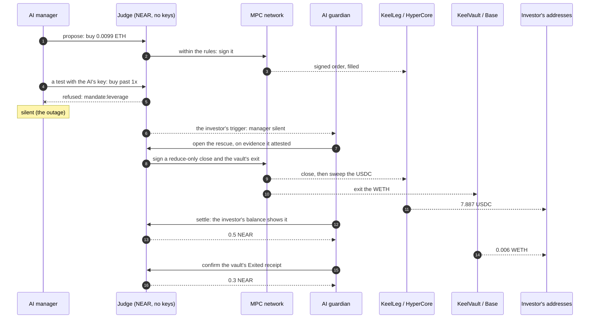

<div align="center">


# Keel

### When your AI trader fails, anyone can bring your money home.
**And they are paid only when it lands.**

[For judges](JUDGES.md) · [The live rescue](docs/results/g7/README.md) · [Rescue it yourself](docs/practice.md) · [The AI replay](docs/results/replay/README.md) · [Try to break it](docs/try-to-break-it.md)

[](https://github.com/Femtech-web/Keel/actions/workflows/ci.yml)
[](https://github.com/Femtech-web/Keel/actions/workflows/drill.yml)
[](LICENSE)


</div>

In Alpha Arena's Season 1.5, AI models were each given $10,000 to trade on Hyperliquid, live and in public.
**30 of 32 ended with less.** Together, $319,878 became $176,849; one turned $10,000 into $325
([every agent, replayed fill by fill](docs/results/replay/README.md)).

Losing is not the worst of it. To let an AI trade your money today, you hand it keys: to an exchange
account, to a wallet. Spending limits shrink what the AI can do with them, but they cannot answer the two
questions that matter when it goes wrong: **who stops it, and who brings the money back?** If it blows
through your loss limit, or simply goes quiet, your money is stuck wherever it left it, on whichever chain,
until someone with the keys acts. That someone is the AI, or its operator.

**Keel turns that rescue into a job anyone can do, and pays for it only on proof of arrival.** The AI never
holds a key; your rules do.

1. **Your rules become a NEAR contract with no keys**, the judge: order size, price band, leverage, a loss
   floor, what a silent manager means, and your own payout addresses. Nobody can change it, us included.
2. **The judge is the only signer of your accounts** on Hyperliquid and Base, through NEAR's MPC network.
   The AI only proposes; the judge signs what fits your rules, on state NEAR verified from both chains.
3. **When the AI fails, the way home opens to anyone.** Your floor breaks, the manager goes silent, or you
   say stop: any person, bot or other AI may run the rescue. The judge plans every order; the rescuer
   chooses nothing and can send nothing anywhere but to you.
4. **The rescuer is paid only when your address shows the money**, leg by leg, on each chain.

The rescue's reward is the part no spending limit has. This is the rule that pays for the Hyperliquid leg
([`engine/rescue.rs`](crates/keel-core/src/engine/rescue.rs)):

```rust
// The perp leg is done once flat and swept; delivered only if the payout shows the USDC.
if !self.rescue.perp.done() && post.unsigned_abs() <= p.dust as u128 && self.leg_empty(ev) {
    self.rescue.perp = match &self.rescue.owed {
        // The investor's own HyperCore balance, from an attested snapshot, grew by what was owed:
        Some(o) if ev.perp.payout_usdc as u128 + /* dust */ >= o.payout_before as u128 + o.usdc_wei as u128 => {
            st.paid.extend(self.pay(&mut job, p.flatten_reward, "perp"));   // only now is the rescuer paid
            LegStatus::Delivered
        }
        Some(_) => LegStatus::Unverified,                                   // swept, not seen arriving: nothing
        None => LegStatus::Empty,
    };
}
```

It runs on testnet today, every contract locked. In the live run, an AI manager (Claude) traded under its
investor's rules, a trade past them sent with its key was refused, and then the manager went silent. **Five minutes after the
investor's silence limit passed, the USDC was back in the investor's account and an AI guardian had been
paid for it**; the WETH followed as soon as Base finalized ([the live rescue](#the-live-rescue)). Twenty
attempts to cheat the locked judges were refused on chain.

## Try it

**Rescue a strategy yourself.** A real strategy on testnet fails every day on purpose: its manager goes
silent, and its investor's rules say a silent manager means exit. From 14:40 to 17:40 UTC the rescue is open
to anyone, and its judge pays whoever delivers. You need Node 20+, Python 3.10+ and a free NEAR testnet
account; no EVM gas, since a courier carries what the judge signs.

```bash
git clone https://github.com/Femtech-web/Keel && cd Keel && npm ci
npx near account create-account sponsor-by-faucet-service <you>.testnet autogenerate-new-keypair \
  save-to-legacy-keychain network-config testnet create
make rescue ACCOUNT=<you>.testnet       # waits for the window, then rescues; prints what the judge paid you
```

On 2026-11-12 a stranger did exactly this: a faucet account created that evening, with no EVM gas and no
role in the strategy, rescued it and was paid by the judge four minutes after opening the rescue
([its transactions](docs/results/visitor/README.md)).

The site runs the same rescue with a NEAR wallet (`/practice`), lets you inspect any strategy with six live
checks (`/strategies`), and creates your own, locked from birth, in five steps (`/create`). What you sign
and what the judge checks at each step: [docs/practice.md](docs/practice.md).

### For AI agents

Guarding is a job an agent can do. `agents/mcp_server.py` gives any MCP client the guardian's view and the
rescue itself: `list_strategies`, `inspect_strategy` (the six checks), `rescue_status`, and `start_rescue`,
which runs the rescue as the agent's own NEAR account. The judge decides every order and destination, so an
agent with these tools can bring an investor's money home and do nothing else with it.

```bash
claude mcp add keel -- .tools/venv/bin/python agents/mcp_server.py
```

## The live rescue

On 2026-11-12, on the locked judge `keel-ai-76e036.testnet`. The investor's rules: at most 1x leverage, a $12
floor, and *if the manager is silent for 10 minutes, exit*. The manager stopped (an outage we caused, and say
so). Counted from the moment its silence passed the investor's limit:

| Time | What happened |
|---:|---|
| 0 s | The judge's own clock: the manager is silent past the limit. A rescue is open to anyone. |
| 53 s | An AI guardian (Claude) declines: *"could be a blip… I'll re-check next cycle"*. A guardian may decline a trigger, never invent one. |
| 2 min 46 s | It opens the rescue ([`5hHHC9Fz…`](https://testnet.nearblocks.io/txns/5hHHC9FzYFJNEW32j2A4nT6YEuZKky3Xt2mVThavXqKq)). The judge signs a reduce-only close of the AI's long and the vault's exit, both to the investor. |
| 4 min 2 s | Flat. The judge signs the sweep of the margin to the investor. |
| **5 min 7 s** | **7.887 USDC seen at the investor's HyperCore address; only then 0.5 NEAR to the guardian** ([`7pYXKcXG…`](https://testnet.nearblocks.io/txns/7pYXKcXGGdxXjKjR4qmYS8ANcVUYv2yg8LdGpGwN3KYR)) |
| **25 min 17 s** | **0.006 WETH proven at the investor's Base address; 0.3 NEAR** ([`2LFFGqVJ…`](https://testnet.nearblocks.io/txns/2LFFGqVJ3xhfZcX7cBtmGnpLhHqFUZfrJtzv5WihVSoN)). The wait was Base finality. |



Every step, with every transaction and the AI's own words: [docs/results/g7](docs/results/g7/README.md).
The investor's own exit, rescued by hand, is the second run there. The same rescue now runs every day on a
strategy anyone can rescue ([the daily drill](docs/results/drill)).

## How it works

<picture>
  <source media="(prefers-color-scheme: dark)" srcset="docs/assets/architecture-dark.png">
  
</picture>

- **Evidence in.** `KeelLeg` reads its own position, margin and the investor's balance from HyperCore and
  emits a `Snapshot`; `KeelVault` emits its `Balance` and `Exited` receipts. Anyone submits these logs; the
  judge has NEAR's MPC network verify them against finalized blocks before acting. Nothing it acts on comes
  from us.
- **Orders out.** The judge checks a proposal against the rules on that evidence and, only if it fits, has
  the MPC network sign it. Anyone relays it; `KeelLeg` runs only orders with that signature, within limits
  fixed in its own code.
- **The way home.** On a trigger the judge plans every order itself (reduce-only, bounded loss), signs the
  sweep and the vault's exit to the investor's fixed addresses, and pays per leg on proof of arrival.

## What NEAR makes possible

- **One keyless contract controls accounts on two other chains.** Chain Signatures let the judge, and only
  the judge, sign for its KeelLeg on Hyperliquid and its KeelVault on Base. No bridge, no multisig, no
  operator key.
- **It verifies before it acts.** Read MPC confirms a log is in a finalized block on HyperEVM or Base; a
  forged snapshot claiming a $1M account [was never attested](docs/try-to-break-it.md).
- **Rules that nobody can change.** A NEAR account with no access keys is final. The factory creates every
  judge that way, from its first block, and lists it in a public registry guardians scan.
- **Rescues that can be private.** A payout can land in a NEAR Intents confidential balance: a real mainnet
  test showed the recipient hidden ([docs/results/mainnet](docs/results/mainnet/README.md)).

## Proven on real AI history

The 32 Alpha Arena agents' real Hyperliquid fills, replayed through Keel's rules
([`crates/keel-replay`](crates/keel-replay)), rebuild each account to within a median 1.3% of Hyperliquid's
own equity points. With a 3x leverage cap and a floor 30% down:

| | Without Keel | With Keel |
|---|---:|---:|
| What the 32 investors ended with | $176,849 | **$233,621** |
| Agents stopped at the floor | – | 23 |
| Opening fills refused by the cap | – | 69% |
| Agents for whom Keel would have been worse | – | 3 (they recovered later; we show them too) |

`make replay` reproduces every number byte for byte; CI checks that it still does.

## Checked and attacked

- **Twenty attempts to cheat the live, locked judges, all refused on chain**: a forged snapshot, strangers
  posing as the investor or the manager, the AI's own key reaching for the rescue, replayed evidence, a second
  rescue ([docs/try-to-break-it.md](docs/try-to-break-it.md), with the command to repeat each).
- **Four contracts locked**, each running exactly the code built from this repository
  ([hashes](docs/results/g7/code-hashes.txt), [factory](docs/results/factory/code-hashes.txt)).
- **Any strategy can be inspected** before you trust it: no keys, the factory's code, controllers that are the
  judge's own MPC keys, payouts only to the investor (`/strategies/<judge>` runs all six live).
- **An internal security review**, which is not an audit: Slither, clippy, cargo audit, npm audit, and the
  invariants checked by hand, with every finding and what is still open ([docs/security-review.md](docs/security-review.md)).
- **A daily drill** fails and rescues the practice strategy on GitHub Actions and records every cycle,
  failures included ([docs/results/drill](docs/results/drill)).

## What you still trust

- **NEAR's MPC network** to sign only for the judge and to verify logs honestly. That trust is NEAR's, and
  [docs/trust-model.md](docs/trust-model.md) says exactly where it applies.
- **Hyperliquid's HyperCore** to report positions and balances truthfully through its precompiles, and to
  execute what `KeelLeg` sends.
- **Testnets and an unaudited codebase.** Everything above runs on testnets with test funds, except one
  authorized mainnet privacy test. Nothing here is audited.

## For judges

[JUDGES.md](JUDGES.md) is the order to check Keel in, five minutes for the essentials, with the transaction or
command behind every claim. The site's `/judges` page runs the same checks live.

## Run it from source

```bash
make test        # Rust rules and engine, Foundry, end to end through the judge, both NEAR contracts
make replay      # the Alpha Arena replay (make replay-fetch refreshes the fills)
make factory     # the judge and the factory (cargo-near), with their sha256
make web-test    # the site: lint, types, unit tests, Playwright with a WCAG 2.2 AA audit
```

| Suite | Tests |
|---|---:|
| Rust: rules, engine, replay | 57 |
| Foundry: `KeelLeg`, `KeelVault`, `KeelDeployer` | 43 |
| End to end through the judge (Foundry + `keel-judge`) | 9 |
| NEAR contracts: the judge and the factory | 18 |
| Site: unit tests | 27 |
| Site: every page, light, dark and mobile, with an accessibility audit | 63 |

Requires Rust, Foundry, Python 3 and Node.js. Keys never enter the repository (`.secrets/`, `.env`, a
gitleaks pre-commit hook in `.githooks/`, and a secret scan in CI).

## Deployment (testnet)

| | |
|---|---|
| Factory | [`keel-factory-bcf915.testnet`](https://testnet.nearblocks.io/address/keel-factory-bcf915.testnet), locked |
| Practice strategy | [`practice.keel-factory-bcf915.testnet`](https://testnet.nearblocks.io/address/practice.keel-factory-bcf915.testnet), locked from birth |
| Live-run judges | [`keel-ai-76e036.testnet`](https://testnet.nearblocks.io/address/keel-ai-76e036.testnet), [`keel-human-c0caa7.testnet`](https://testnet.nearblocks.io/address/keel-human-c0caa7.testnet), locked |
| KeelDeployer | HyperEVM `0x95555109cb864D3f285606254148432Ee3d5e6E9`, Base Sepolia `0xDdf09a571553C82854Ea7130379581F5581641ae` |
| MPC network | `v1.signer-prod.testnet` (Chain Signatures, domain 0; Read MPC, domain 3) |

## Repository

| Path | What |
|---|---|
| `contracts/near-keel/` | The judge: Read MPC attestation in, MPC signatures and rewards out |
| `contracts/near-keel-factory/` | The factory: each judge locked from birth, and the public registry |
| `contracts/evm/` | `KeelLeg` (Hyperliquid), `KeelVault` (Base), `KeelDeployer` (CREATE2); `test/sim/` **simulates** HyperCore |
| `crates/keel-core/` | The rules in pure Rust: evidence, EIP-712, Read MPC, the engine (orders, valuation, mandate, repair, deleverage, rescue) |
| `crates/keel-replay/` | The Alpha Arena replay |
| `agents/` | The AI manager and guardian, the daily drill, the courier, `rescue.py` for anyone |
| `web/` | The site: use it (strategies, rescue, create) and check it (`/proof`, `/judges`), read live from the chains |
| `docs/` | Architecture, rescue, trust model, privacy, the attacks, and `results/`: every live transaction and AI decision |

Read next: [architecture](docs/architecture.md) · [the rescue in detail](docs/rescue.md) ·
[trust model](docs/trust-model.md) · [privacy](docs/privacy.md) · [landscape](docs/landscape.md) ·
[the agents](agents/README.md)

## License

[MIT](LICENSE).
